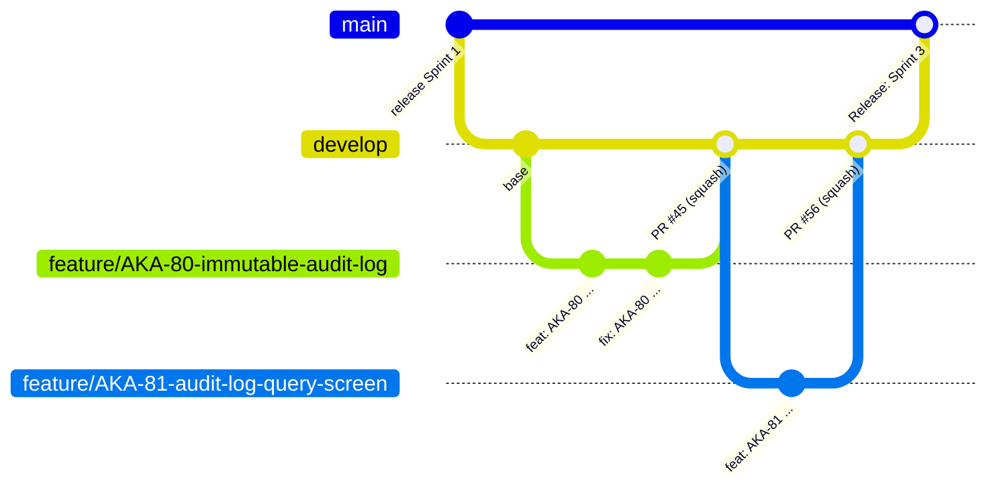

# Estratégia de Branch, Commits e Pull Requests

O **padrão** (nomes, formatos, exemplos) está nas [Project Guidelines do README](../README.md#project-guidelines). Este documento explica **por que** o time escolheu esse processo e como ele é garantido.

## Visão geral

| Branch | Para quê | Quem escreve nela |
|---|---|---|
| `main` | Só versões entregues (uma release por Sprint) | Ninguém diretamente: só recebe o PR de release da `develop` |
| `develop` | Integração do trabalho da Sprint | Ninguém diretamente: só recebe PRs aprovados |
| `<tipo>/AKA-<número>-descricao` | Uma tarefa do Jira | Quem pegou a tarefa |

## Por que essa estratégia

### Por que `main` + `develop` + uma branch por tarefa (Git Flow simplificado)

- **A `main` precisa estar sempre apresentável.** Ela é o que os professores e o parceiro veem ao fim de cada Sprint. Com a `develop` no meio, o trabalho em andamento nunca chega na `main` antes da release.
- **Uma branch por tarefa combina com a regra de uma tarefa por pessoa.** O time trabalha uma tarefa de cada vez por pessoa; cada branch é uma tarefa, e cada PR fecha uma tarefa do Jira. Fica fácil saber o que está em revisão e o que falta.
- **O time tem disponibilidade e experiência diferentes.** Cada um trabalha isolado na sua branch, no seu ritmo, sem quebrar o trabalho dos outros. A integração acontece só pelo PR, depois de revisada.
- **Não usamos branches de `release` e `hotfix` do Git Flow completo.** Com uma entrega por Sprint e sem produção em uso pelo cliente, elas só acrescentariam passos sem ganho.

### Por que o código da tarefa no nome da branch e no commit

- O Jira liga sozinho a branch, os commits e o PR ao card quando encontram o `AKA-<número>`. Quem abre a tarefa vê o código, e quem abre o código vê a tarefa e os critérios de aceite.
- O revisor confere o PR **contra os critérios de aceite do card**, então o vínculo precisa ser automático e confiável.
- No relatório de acompanhamento semanal, o histórico por tarefa sai direto do Git.

### Por que o padrão de commit (Conventional Commits, com o código da tarefa)

- O **tipo** (`feat`, `fix`, `docs`, `test`...) mostra de relance o que cada mudança é, sem abrir o diff.
- Um formato único deixa o histórico legível mesmo com seis pessoas commitando de jeitos diferentes.
- Como o merge é **squash**, o título do PR vira o commit da `develop`: por isso o título do PR segue o mesmo padrão e é validado.

### Por que Pull Request com aprovação obrigatória e Squash and merge

- **Revisão obrigatória** (pelo menos 1 aprovação, e o autor não aprova o próprio PR): a regra está **configurada no GitHub**, não é só combinada. É a última barreira antes da `develop`.
- **Squash and merge**: o time costuma fazer muitas alterações num mesmo PR, com vários commits de ajuste. O squash deixa **um commit por tarefa** na `develop`, fácil de ler e de desfazer se preciso.

### Por que automatizar em vez de só combinar

Combinado e documentado, o padrão é esquecido na correria; automatizado, ele é aplicado **antes** de virar problema, sem depender de alguém lembrar ou cobrar.

| Onde | O que valida | Quando |
|---|---|---|
| `pre-commit` (na máquina) | Nome da branch, formato do commit, lint (Ruff no back; ESLint e Prettier no front) | Antes de cada commit |
| GitHub Actions (CI) | Lint, testes unitários, testes de integração com PostgreSQL, build, título do PR, requisito vindo do Jira | Em cada PR e push |
| SonarQube Cloud | Cobertura, bugs, vulnerabilidades e duplicação do código novo | Em cada PR |
| Regras da branch no GitHub | Aprovação obrigatória e checks obrigatórios para o merge | No merge |

O retorno chega **na hora**, com a explicação do formato esperado, o que serve também como aprendizado para quem tem menos experiência. E a revisão humana fica livre para olhar o que importa: os critérios de aceite e a lógica.

## Ciclo de uma tarefa

1. Pegar a tarefa no Jira e movê-la para **Em andamento**.
2. Criar a branch a partir de `develop` (pelo botão *Create branch* do card ou `git checkout -b <tipo>/AKA-<número>-descricao`).
3. Commitar no padrão (os hooks validam).
4. Abrir o PR para `develop`, preencher o template e mover a tarefa para **Em análise**.
5. CI verde, Quality Gate do Sonar e 1 aprovação de outra pessoa.
6. **Squash and merge**, apagar a branch e mover a tarefa para **Concluído**.
7. No fim da Sprint, a PO abre o PR de release `develop` → `main` (`Release: vX.Y.Z — Sprint N delivery`).
