# Manual de Usuário — AkaVision

O **AkaVision** é o portal de documentos técnicos da AKAER: envio e validação de documentos, busca e perguntas com IA sobre o acervo, visualização segura e controle de privacidade (LGPD).

Para instalar e rodar o sistema, veja o [Manual de Instalação](manual-instalacao.md).

## Sumário

1. [Perfis de acesso](#1-perfis-de-acesso)
2. [Entrar no sistema](#2-entrar-no-sistema)
3. [Início: perguntar à IA](#3-início-perguntar-à-ia)
4. [Documentos: consultar e visualizar](#4-documentos-consultar-e-visualizar)
5. [Enviar um documento](#5-enviar-um-documento)
6. [Meus documentos: acompanhar e reenviar](#6-meus-documentos-acompanhar-e-reenviar)
7. [Validação (administrador)](#7-validação-administrador)
8. [Gestão de Usuários (administrador)](#8-gestão-de-usuários-administrador)
9. [Auditoria (administrador)](#9-auditoria-administrador)
10. [Meus dados e privacidade (LGPD)](#10-meus-dados-e-privacidade-lgpd)
11. [Dúvidas frequentes](#11-dúvidas-frequentes)

---

## 1. Perfis de acesso

| Perfil | Menus | O que pode fazer |
|---|---|---|
| **Engenharia** | Início, Documentos, Meus documentos | Perguntar à IA, consultar e visualizar documentos, enviar documentos e acompanhar os próprios envios |
| **Qualidade** | Início, Documentos, Meus documentos | O mesmo que Engenharia, com as áreas e os níveis de sigilo do seu perfil |
| **Administrador** | Todos os acima, mais Validação, Gestão de Usuários e Auditoria | Aprovar ou devolver documentos (nunca os próprios), cadastrar usuários e consultar o log de auditoria |

**O que cada pessoa enxerga depende da área e do nível de sigilo.** Cada usuário tem permissão em certas áreas, até um nível de sigilo máximo em cada uma (Público, Interno, Restrito, Confidencial). Documentos fora dessa permissão não aparecem na busca, não são usados pela IA e, se alguém tentar abrir, aparece só "Acesso não autorizado".

## 2. Entrar no sistema

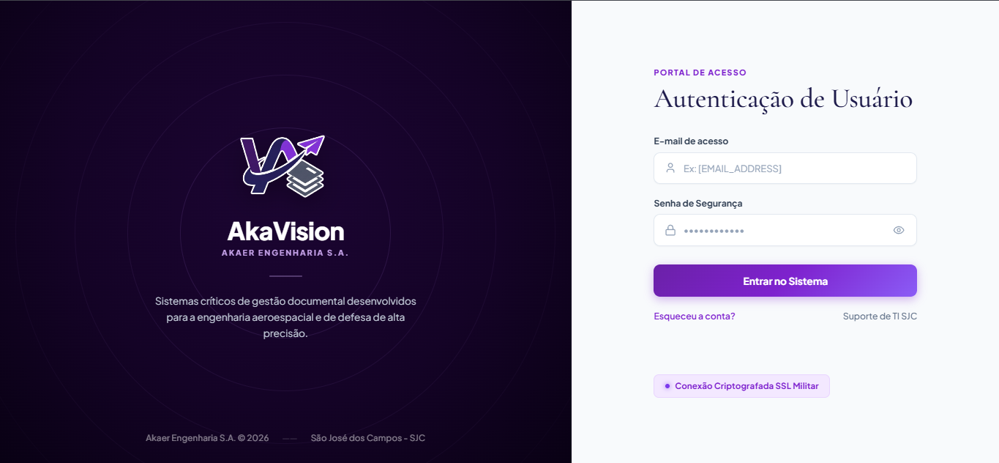

1. Informe o e-mail corporativo e a senha e clique em **Entrar no Sistema**.
2. Leia os **Termos de Uso e Política de Privacidade** e clique em **Aceitar e Continuar**. Eles aparecem a cada login. Sem aceitar (**Recusar Termos**), você volta para o login.

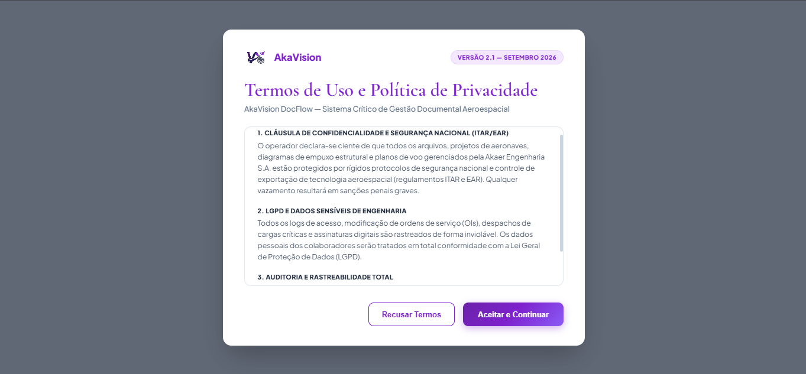

- Por segurança, a mensagem de erro é a mesma para e-mail ou senha errados.
- Depois de **5 tentativas erradas**, a conta fica bloqueada por **15 minutos**.
- A sessão expira depois de 60 minutos; aí é só entrar de novo.

## 3. Início: perguntar à IA

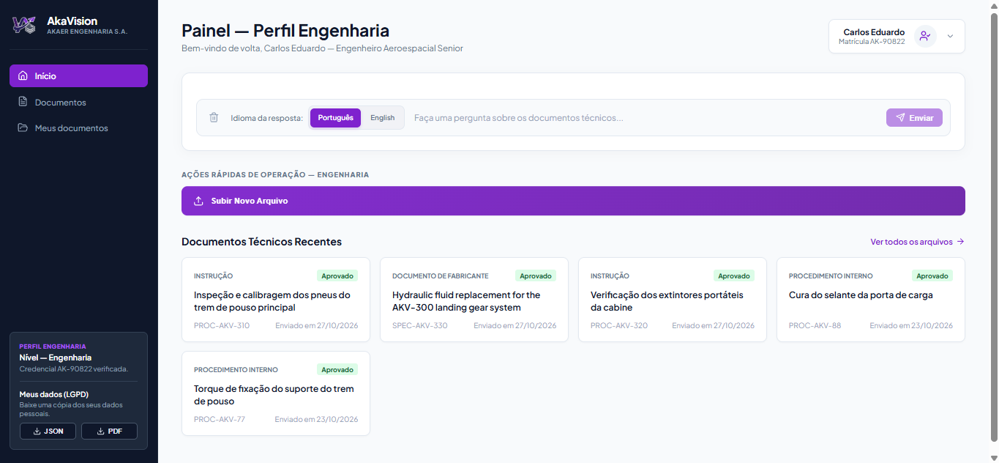

1. Escolha o **idioma da resposta** (Português ou English).
2. Digite a pergunta sobre os documentos técnicos (até 1000 caracteres) e clique em **Enviar**.

A resposta vem em **dois blocos separados**:

- **Extraído do documento:** o trecho literal, com documento, revisão, página e seção de onde veio.
- **Interpretação da IA:** o texto gerado pela IA a partir dos trechos, com o aviso de que **não é uma determinação oficial da empresa**.

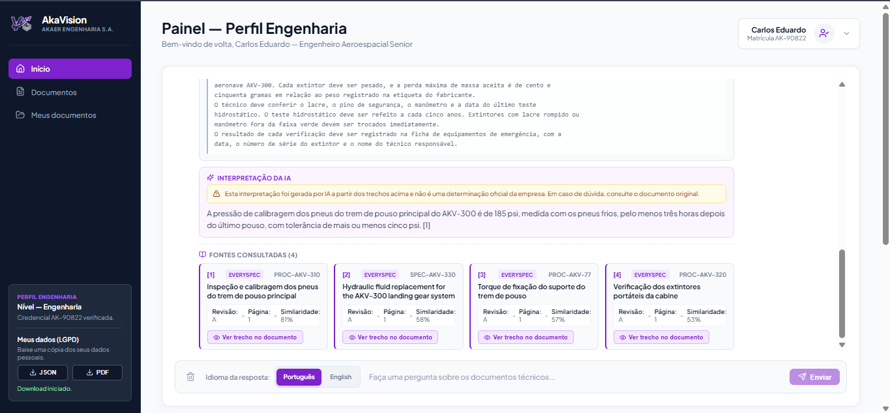

- A IA só usa documentos **disponíveis** que **você tem permissão para ver**. Duas pessoas com permissões diferentes podem receber respostas diferentes para a mesma pergunta.
- Quando não há base nos documentos, a IA avisa que não encontrou, em vez de inventar.
- A IA roda nos servidores da empresa: a pergunta e os documentos não saem para serviços externos.

Na mesma tela aparecem os **documentos técnicos recentes** e o atalho **Subir Novo Arquivo**.

## 4. Documentos: consultar e visualizar

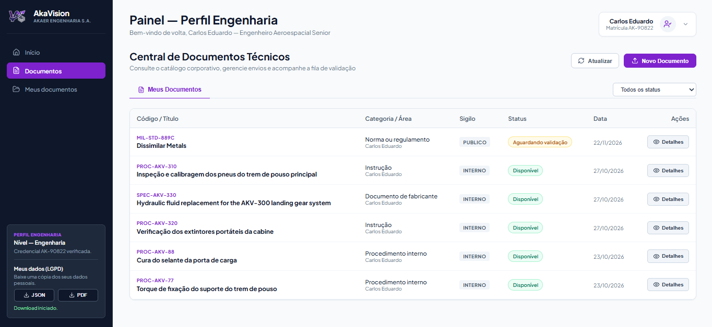

A **Central de Documentos Técnicos** lista os documentos que você pode ver. Clique em **Detalhes** para abrir as informações do documento (título, status, nível de sigilo, tipo, autor/responsável, histórico) e o **visualizador**.

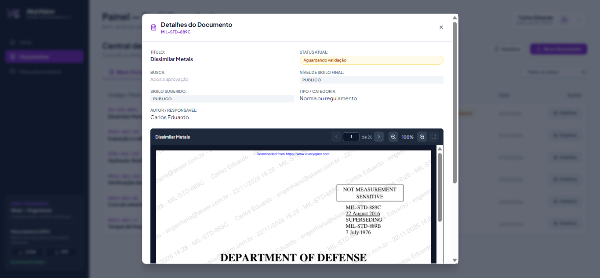

- O documento aparece **página por página, como imagem**, com uma **marca d'água** com seu nome, e-mail, data/hora e o código do documento. O arquivo original não é baixado para o computador.
- Use as setas para trocar de página, a lupa para aproximar e o botão de tela cheia.
- Toda abertura fica registrada no log de auditoria.

Se o documento for de uma área ou nível de sigilo fora da sua permissão, aparece só **"Acesso não autorizado"**, sem título nem conteúdo.

## 5. Enviar um documento

Clique em **Novo Documento** (em Documentos), **Enviar documento** (em Meus documentos) ou **Subir Novo Arquivo** (no Início).

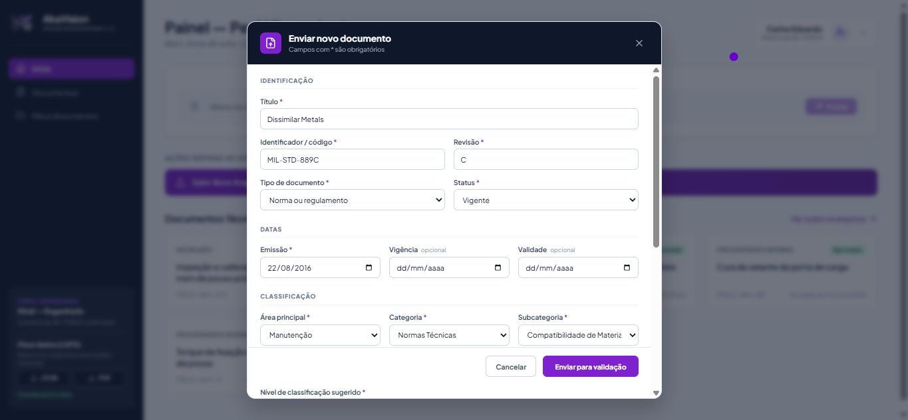

Preencha os campos. Os obrigatórios são:

| Campo | Exemplo |
|---|---|
| Título | Manual de manutenção |
| Identificador / código | MAN-001 |
| Tipo de documento | Manual, Norma, Procedimento interno... |
| Número da revisão | 01 |
| Data de emissão | |
| Área principal, categoria e subcategoria | (áreas secundárias são opcionais) |
| Status | Vigente, Substituído, Cancelado ou Em revisão |
| Nível de sigilo | Público, Interno, Restrito ou Confidencial |
| Origem / fonte | Eng. de Produto |
| Responsável | |
| Idioma | |
| Arquivo | **Só PDF, até 10 MB** |

Opcionais: data de vigência, data de validade, referência normativa (ex.: NBR 5410, MAN-002 rev. 03).

Clique em **Enviar**. O documento vai para a **fila de validação** e só aparece na busca e para a IA **depois de aprovado** por um administrador. O nível de sigilo que você escolheu é uma **sugestão**: quem valida pode ajustar.

Não é possível enviar dois documentos com o mesmo identificador e a mesma revisão.

## 6. Meus documentos: acompanhar e reenviar

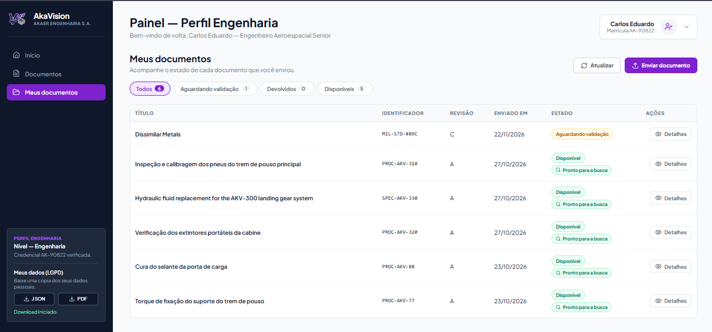

Lista os documentos que **você** enviou, com abas por situação:

| Situação | Significa |
|---|---|
| **Aguardando validação** | Ainda não foi analisado |
| **Devolvido** | O validador pediu correções. O comentário dele aparece no documento |
| **Disponível** | Aprovado: já aparece na busca e para a IA |

Para corrigir um documento **devolvido**, clique em **Corrigir e reenviar**, ajuste os campos (e, se precisar, troque o arquivo) e envie de novo. Ele volta para a fila de validação.

A etiqueta de **processamento** mostra se o documento aprovado já foi preparado para a IA.

## 7. Validação (administrador)

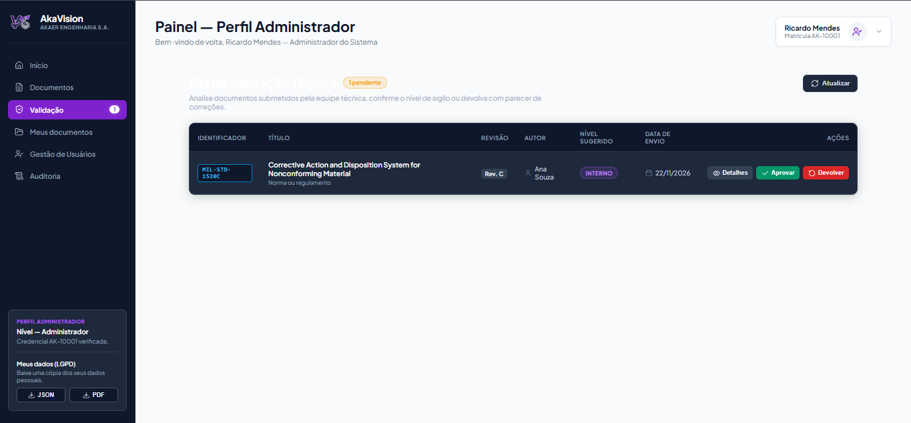

A **Fila de Validação Técnica** lista os documentos aguardando análise. **Os documentos que você mesmo enviou não aparecem** na sua fila: quem envia não aprova o próprio documento.

Abra o documento, confira as informações e o conteúdo no visualizador e escolha:

- **Aprovar:** confirme ou ajuste o **nível de sigilo final**. Aprovar como **Confidencial** pede uma confirmação extra. O documento fica **disponível** e é processado para a IA automaticamente.
- **Devolver:** escreva o que precisa ser ajustado (o comentário é obrigatório). O documento volta para o autor em **Meus documentos**.

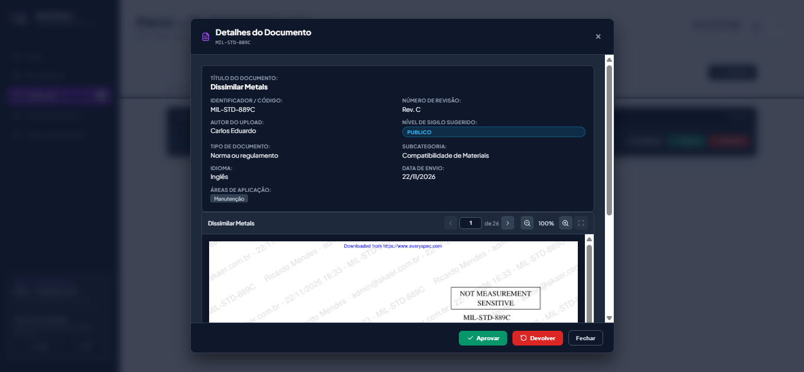

Toda decisão fica no histórico do documento e no log de auditoria.

## 8. Gestão de Usuários (administrador)

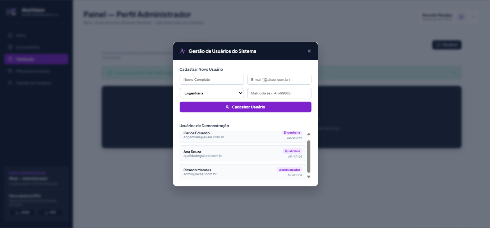

O menu **Gestão de Usuários** (ou o atalho na tela inicial do administrador) abre a janela de **cadastro de usuário**: informe nome, e-mail, perfil (Engenharia, Qualidade ou Administrador) e matrícula, e confirme.

## 9. Auditoria (administrador)

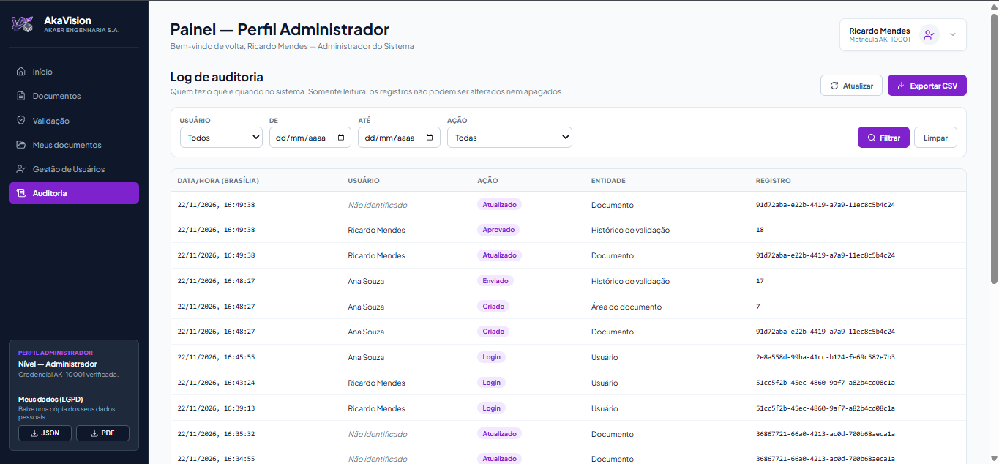

Mostra **quem fez o quê e quando** no sistema, do mais recente para o mais antigo: logins (inclusive os que falharam), envios, aprovações, devoluções, alterações em documentos, exportações de dados pessoais e visualizações de documentos.

1. Filtre por **usuário**, **período** (de/até) e **ação**, em qualquer combinação, e clique em **Filtrar**. **Limpar** volta para a lista completa.
2. Use **Anterior/Próxima** para navegar (20 registros por página).
3. Clique em **Exportar CSV** para baixar o resultado filtrado (abre direto no Excel).

- Datas e horas estão no **horário de Brasília**.
- **Usuário removido:** a conta não existe mais. **Não identificado:** a ação não tem usuário (por exemplo, login com um e-mail que não existe, ou uma alteração feita pelo próprio sistema).
- A tela é **só de leitura**: ninguém, nem o administrador, consegue alterar ou apagar um registro do log.

## 10. Meus dados e privacidade (LGPD)

### Ver e corrigir seus dados

Clique no seu nome, no canto superior direito, e em **Meus dados**.

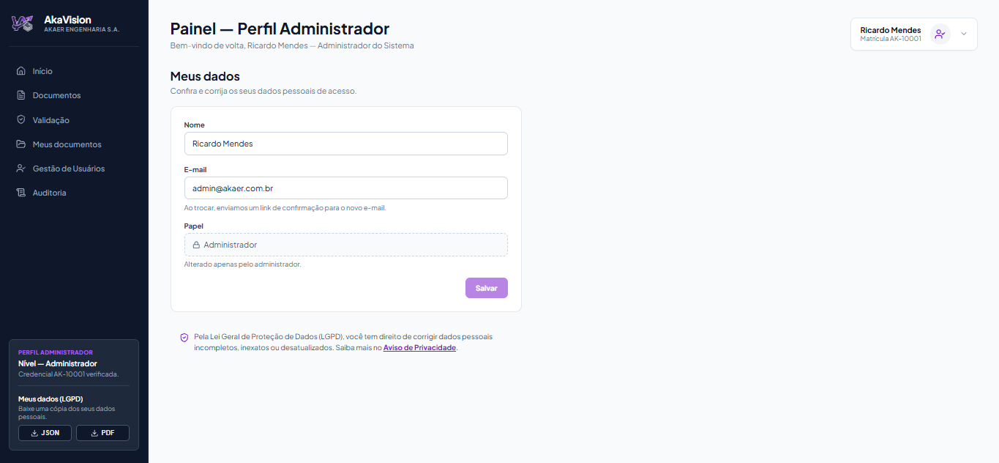

- Altere o **nome** e clique em **Salvar**: o nome muda na hora.
- Para trocar o **e-mail**, informe o novo e salve. O sistema envia um **link de confirmação** para o novo endereço; até você clicar nele, continue entrando com o e-mail atual. Se o link não chegar, use **Reenviar link**.
- O **papel** só pode ser alterado por um administrador.
- O link **Aviso de Privacidade** explica quais dados o sistema guarda e por quê.

### Baixar uma cópia dos seus dados

No canto inferior esquerdo, em **Meus dados (LGPD)**, clique em **JSON** ou **PDF**.

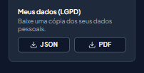

O arquivo traz seus dados de conta, seus envios, o histórico de validação e seus acessos a documentos. Por segurança, **não** traz senha nem o conteúdo dos documentos. É possível baixar **uma vez por minuto** e até **5 vezes por dia**.

## 11. Dúvidas frequentes

**Não encontro um documento que sei que existe.**
Ele pode estar fora da sua permissão (área ou nível de sigilo) ou ainda aguardando validação. Fale com o administrador.

**A IA respondeu que não encontrou.**
A IA só responde com base nos documentos disponíveis que você pode ver. Tente reformular a pergunta ou verifique se o documento já foi aprovado.

**Apareceu "Acesso não autorizado".**
O documento existe, mas está fora da sua permissão. Peça acesso ao responsável pela área.

**Minha conta foi bloqueada.**
Foram 5 tentativas de login erradas. Espere 15 minutos e tente de novo.

---

### Prints a incluir

Salve as imagens em `docs/imagens/manual/` com estes nomes:

| Arquivo | Tela | Usuário |
|---|---|---|
| `01-login.png` | Login | — |
| `02-termos.png` | Termos de Uso | qualquer, logo depois do login |
| `03-inicio.png` | Início | engenharia |
| `04-resposta-ia.png` | Resposta da IA com os dois blocos | engenharia |
| `05-documentos.png` | Central de Documentos | engenharia |
| `06-visualizador.png` | Detalhes + visualizador com marca d'água | engenharia |
| `07-upload.png` | Formulário de envio | engenharia |
| `08-meus-documentos.png` | Meus documentos | engenharia |
| `09-validacao.png` | Fila de Validação | admin |
| `10-aprovar-devolver.png` | Modal de aprovar ou devolver | admin |
| `11-gestao-usuarios.png` | Gestão de Usuários | admin |
| `12-auditoria.png` | Log de auditoria | admin |
| `13-meus-dados.png` | Meus dados | qualquer |
| `14-exportar-dados.png` | Botões JSON/PDF de Meus dados (LGPD) | qualquer |
